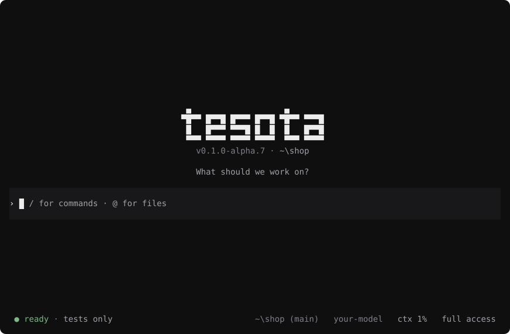
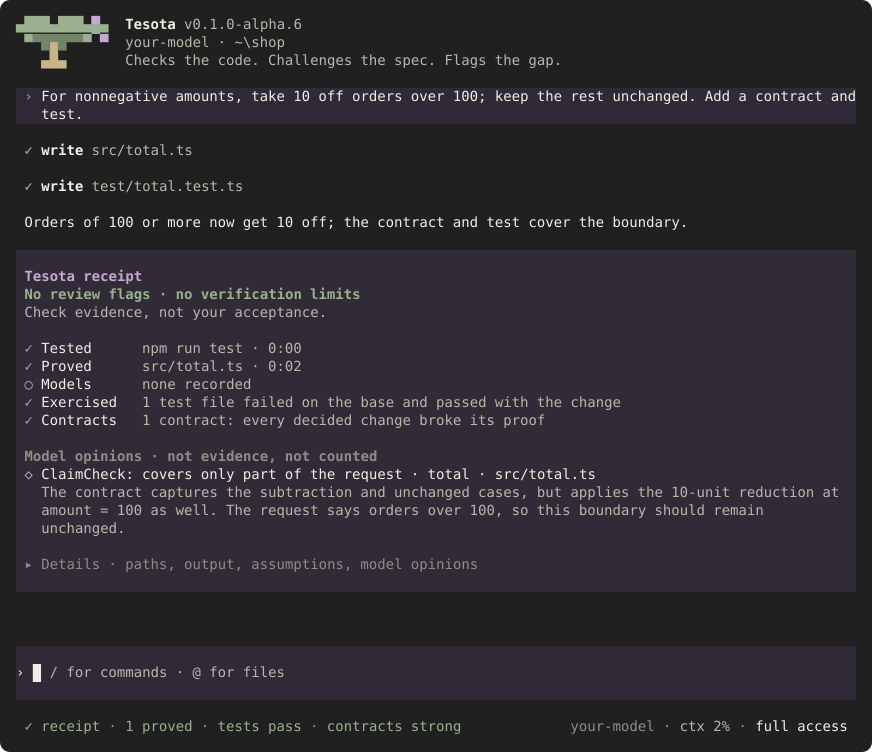

# Tesota

<picture>
  <source media="(prefers-color-scheme: light)" srcset="docs/assets/tesota-welcome-light.svg">
  
</picture>

**Tesota is a coding agent that shows evidence its change does what you
asked.** When the agent finishes, Tesota proves the change where it can,
tests it where it can't, and tells you plainly what it couldn't verify.
The run doesn't end until that's done.

<picture>
  <source media="(prefers-color-scheme: light)" srcset="docs/assets/tesota-turn-light.svg">
  
</picture>

## What Tesota checks

- **Proofs.** TypeScript functions with LemmaScript contracts are proved
  with Dafny.
- **Tests.** Your project's own check and test commands run against the
  change, and Tesota tells you whether a new test actually catches it.
- **Contract strength.** A contract that still proves when the code is
  changed is too weak to trust, and goes back to the agent.
- **Weakened evidence.** A loosened contract, a deleted test or an added
  `.skip` is listed for you to decide.
- **What nothing verified.** Changed lines and files outside any check are
  listed, never hidden behind a passing check.

Failures go back to the agent until they're fixed or stop changing. Every
run ends with a **receipt**, which `tesota receipt` writes for a pull
request. A receipt is check evidence: accepting the change is still yours.

## Get started

Tesota is in alpha and not published yet. You need [Bun](https://bun.sh)
and Git; [Dafny 4](https://dafny.org) to prove contracts.

```sh
git clone https://github.com/sequelcore/tesota
cd tesota
bun install --frozen-lockfile --ignore-scripts
bun run vendor
cd packages/core && bun link
```

Then, in your project:

```sh
cd my-project
tesota
```

Type `/login` to sign in to a model provider, and ask for a change.
[Install](docs/get-started/install.md) and
[your first session](docs/get-started/first-session.md) go step by step.

## Documentation

| | |
| --- | --- |
| [Get started](docs/get-started/install.md) | Install Tesota and run your first verified request |
| [Guides](docs/README.md#guides) | Sessions, verification, receipts, permissions, models, hooks, MCP and more |
| [Concepts](docs/README.md#concepts) | How Tesota is built and how it verifies |
| [Reference](docs/README.md#reference) | Commands, keys, configuration files and the receipt format |
| [Roadmap](ROADMAP.md) | What Tesota is for, what it won't do, and what comes next |
| [Contributing](CONTRIBUTING.md) | Build, test and send a change |

## Credits

Tesota proves contracts with [LemmaScript](https://github.com/midspiral/LemmaScript)
by Midspiral and [Dafny](https://github.com/dafny-lang/dafny). Its contract
comparison adapts the round-trip method of
[ClaimCheck](https://github.com/metareflection/claimcheck) by metareflection.
It runs on [pi-ai](https://github.com/earendil-works/pi) for model access and
pi-tui for the terminal. See [NOTICE](NOTICE).

Tesota is named for *Olneya tesota*, the desert ironwood, *palo fierro* in
Spanish: a tree of the Sonoran Desert whose wood sinks in water, and under
whose shelter other plants take root.

Licensed under [Apache-2.0](LICENSE).
