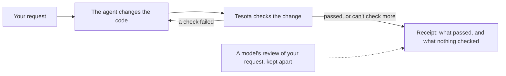

<h1>
  <picture>
    <source media="(prefers-color-scheme: light)" srcset="docs/assets/tesota-wordmark-light.svg">
    
  </picture>
</h1>

<!-- DRAFT: the owner writes the tagline. The idea it carries: the agent's
work doesn't reach you until its checks pass, and what nothing checked is
said. The current one stays until then. -->
**A coding agent that checks its code, challenges its specs, and flags where they may miss your request.**

[](https://github.com/sequelcore/tesota/actions/workflows/ci.yml)
[](https://github.com/sequelcore/tesota/releases)
[](LICENSE)

<!-- DRAFT: why, in facts; the owner rewrites the wording. -->
A coding agent says it's done, and the tests it wrote pass. That proves
less than it seems: a test can pass without noticing the change, a
contract can allow the wrong code, and nothing compares the work with what
you asked.

Tesota doesn't take the agent's word. When the agent finishes, Tesota runs
the checks, and a check that fails goes back to the agent with what failed.
The work reaches you when the checks pass, or when nothing more can be
checked, with a receipt that says which.



<!-- DRAFT: replace with a frame of a real case from the launch video, a run
where a check fails, goes back and the fix passes. The scripted image stays
until then. -->
<picture>
  <source media="(prefers-color-scheme: light)" srcset="docs/assets/tesota-turn-light.svg">
  
</picture>

## Install

```sh
curl -fsSL https://raw.githubusercontent.com/sequelcore/tesota/main/install.sh | sh
```

On Windows, in PowerShell:

```powershell
irm https://raw.githubusercontent.com/sequelcore/tesota/main/install.ps1 | iex
```

Then, in your project, run `tesota` and type `/login`. You need Git, and
[Dafny 4](https://dafny.org) to prove contracts. Tesota is in alpha;
[Install](docs/get-started/install.md) has the details.

## What it checks

- **Tests:** your project's own commands, on the change, and whether a new
  test fails without it.
- **Proofs:** TypeScript contracts proved with Dafny. A contract that still
  proves after Tesota changes the code is too weak.
- **Design models:** TLA+ and Quint, checked with TLC when the change
  touches the code they cover.

A deleted test, an added `.skip` or a loosened contract is flagged for you.
The receipt keeps a model's review of your request apart from the
evidence, and never counts it as verified; `tesota receipt` prints it as
Markdown for a pull request, and `--json` for CI.
[How verification works](docs/concepts/verification.md) and
[Receipts](docs/guides/receipts.md) explain the rest.

Use the model you already pay for: any [pi-ai](https://github.com/earendil-works/pi)
provider, a Claude plan through your own Claude Code, or a ChatGPT plan.
See [Models](docs/guides/models.md).

## Documentation

[Get started](docs/get-started/install.md) · [Guides](docs/README.md#guides) ·
[Concepts](docs/README.md#concepts) · [Reference](docs/README.md#reference) ·
[Roadmap](ROADMAP.md) · [Changelog](CHANGELOG.md) ·
[Contributing](CONTRIBUTING.md) · [Security](SECURITY.md)

## Credits

Tesota proves contracts with [LemmaScript](https://github.com/midspiral/LemmaScript)
and [Dafny](https://github.com/dafny-lang/dafny), checks design models with
[TLC](https://github.com/tlaplus/tlaplus) and [Quint](https://github.com/informalsystems/quint),
and adapts [ClaimCheck](https://github.com/metareflection/claimcheck)'s
round-trip method. It runs on [pi-ai](https://github.com/earendil-works/pi),
pi-tui and pi-mcp. [NOTICE](NOTICE) lists every credit and license.

Named for *Olneya tesota*, the desert ironwood of the Sonoran Desert, whose
wood sinks in water and under whose shelter other plants take root.
Licensed under [Apache-2.0](LICENSE).
