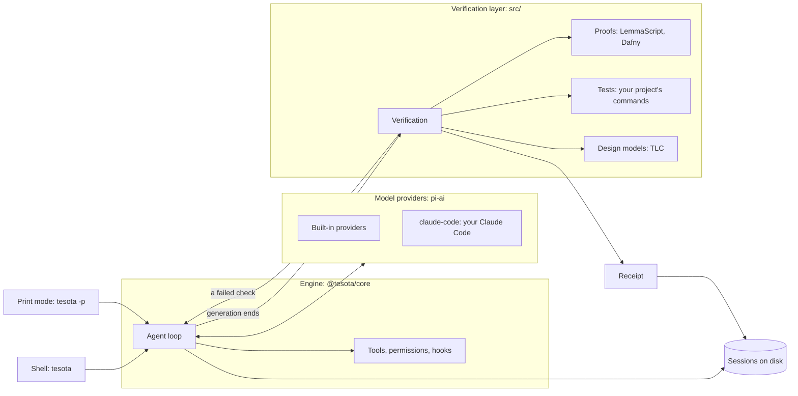

# Architecture

When you ask Tesota to change a file, the engine runs the agent and the
verification layer checks the result before the run ends. The engine
owns tools, permissions and saved sessions; the verification layer owns
checks and receipts. Tesota has its own engine so verification is required
by the run lifecycle, pending input cannot be overlooked when a run ends,
and your original request survives conversation compaction.

## Parts

| Part | Source | Responsibility |
| --- | --- | --- |
| Engine (`@tesota/core`) | `packages/core/src/` | Command line, agent loop, tools, sessions, permissions, workspaces, hooks, MCP, instructions, skills and terminal shell |
| Verification layer | `src/` | Proofs, project checks, design model checks, evidence limits and receipts |
| Integration contract | `src/contract.ts`, `src/host.ts` | The events, tools, model access and terminal features the verification layer uses |

The engine runs the agent, the verification layer checks its change, and both write to the saved session.

The engine runs on [Bun](https://bun.sh). Model access comes from pi-ai,
the terminal from pi-tui and MCP integration from pi-mcp. Proofs use
LemmaScript and Dafny; tests use your project's commands. Tesota does not
provide a sandbox. See [Permissions](../guides/permissions.md) for the
boundaries on tool calls.

## Runs

A [run](../reference/glossary.md) starts with your request:

1. Tesota records your request and its starting commit or snapshot before
   the agent works.
2. The agent's tool calls pass permission checks and hooks. Each call's
   intent is saved before it starts.
3. When generation ends, extension handlers finish first. Their requests
   to continue accumulate. The required verifier then checks the result.
4. Verification can send failures back to the agent. Otherwise the run
   ends, with a receipt when there was a change to verify.

A run cannot finish as completed while a job it started is still running
or input remains unseen. A stopped run, provider failure, failed handler
or unresolved blocking question can end the run without completing the
request. See [How verification works](verification.md) for checks,
standing and interrupted-session recovery.

## Sessions

A session is a conversation saved as an append-only JSON Lines file under
`~/.tesota/sessions/`. An operating-system lock allows one writer at a
time and releases when the process ends.

The session keeps your request, amendments and submitted answers in their
recorded order. Withdrawing pending input records its withdrawal. When
older conversation is summarized to fit the context window, the original
request input is restored alongside the summary. Verification reads that
saved input rather than relying on the summary to remember it.

A session works in a workspace: the checkout, or a separate Git worktree
when another session already holds it. Tools, checks and receipts use that
workspace. Closing a session removes its worktree only if it has no
changes to keep. See [Sessions](../guides/sessions.md) for opening,
switching and resuming sessions, and [Subagents](../guides/subagents.md)
for work delegated to another session.

## Integration

The verification layer uses `src/contract.ts` rather than importing the
engine. The engine supplies its version, terminal keys, shell execution
and operating-system locks through `src/host.ts`.

Project integration uses files you can inspect: `AGENTS.md` or
`CLAUDE.md`, Agent Skills (`SKILL.md`), command hooks and MCP server
configuration. See [Configuration](../reference/configuration.md) for
paths and [Development](../development.md) for the source layout.
