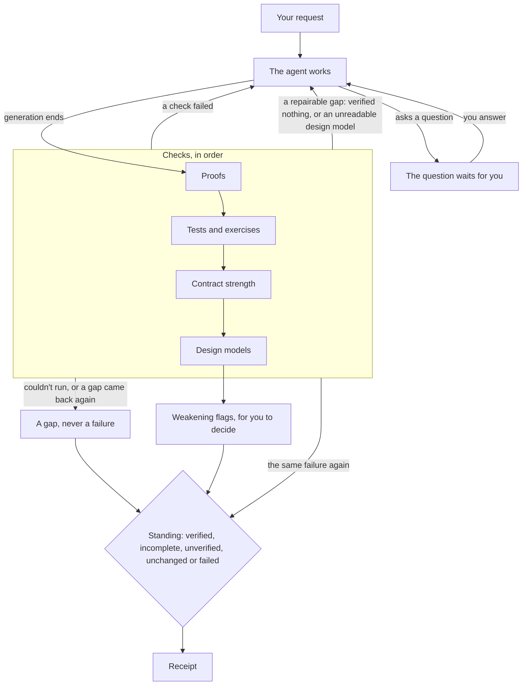

# How verification works

Suppose you ask Tesota to fix a calculation and add a test. When the agent
finishes, Tesota runs the project's checks, and if they pass, it runs the
new test on the starting code to see whether the test notices the change.
The receipt keeps those apart: a passing test and a test that detects the
change establish different things.

Verification checks results; [permissions](../guides/permissions.md)
control actions. The receipt records evidence and its limits; accepting
the change is yours.

Failed checks and repairable gaps go back to the agent; the gaps that
remain reach the receipt.

## Evidence

| Kind | Establishes | Main limit |
| --- | --- | --- |
| Proof | The contracts hold for every admitted input, in LemmaScript's model of TypeScript, checked with Dafny | The contract may omit what you wanted; the model isn't JavaScript's runtime |
| Project checks | Your project's commands passed | A command establishes only what it checks |
| Test exercise | A changed test fails on the starting code and passes with the change | The test's expected result may be wrong |
| Contract strength | Small changes to a function's body break its proof, apart from changes proved equivalent | Only the generated changes were tried |
| Design model check | The declared properties hold in every reachable state, as configured | The model can leave out behavior the code has |

Two more steps are a model's judgment: ClaimCheck compares contracts with
your request, and the open-cases list names inputs your request leaves
ambiguous. They stay apart in the receipt and never count as evidence.

## What gets checked

Verification starts when generation ends, if a tool call that may change
files ran and something changed. Tesota recorded the starting commit, or a
snapshot outside Git, before the agent's first such call, so a commit made
during the request can't hide a file. Then, in order:

1. Prove changed TypeScript files that carry contracts.
2. Run the commands of the projects that own the changed files, then try
   changed tests on the starting code.
3. Measure new or changed contracts, and compare them with your request.
4. Check affected design models and their planted faults.
5. List open cases, confirm the evidence still matches the files, and
   publish the receipt.

## Repairs

A failed check, or one that checked nothing, goes back to the agent with
what failed, unless the same failure already went back during this
request; then it is recorded as no progress. A failing project command
first runs again on the starting commit: only a failure the base had in the
same tests, by their test reports, stays from the agent. A check that
can't start, runs out of time or is cancelled is a limit for you, not a
repair. A run gets at most 32 automatic continuations.

## Standing

| Standing | Meaning |
| --- | --- |
| `failed` | A check ran and showed the change wrong |
| `incomplete` | Evidence passed but gaps remain, or the run stopped or needs a decision |
| `unverified` | Something changed and no check passed on the current content |
| `unchanged` | Nothing changed |
| `verified` | Evidence passed, every changed path is covered, and no gap or decision remains |

A check that couldn't run, ran past its limit, checked nothing or is stale
is a gap, never a failure. Coverage means a path proved, or was tested and
exercised. [Receipt v2](../receipt-v2.md#standing) specifies the exact
interpretation, and [Proved rules](../reference/proved-rules.md) lists the
decisions Tesota proves about itself.

## What evidence can't establish

A proof is as good as its contract. A design model covers its declared
abstraction. A passing command says nothing about what it doesn't check.
Content hashes aren't an atomic snapshot, so another writer can change a
file after a read. Before publishing, Tesota drops a pass whose files
changed since the check.

[Checks](../reference/checks.md) has every rule each check follows: what a
proof covers, how tests are chosen, planted faults, weakening flags,
export, and recovery after a stop.
