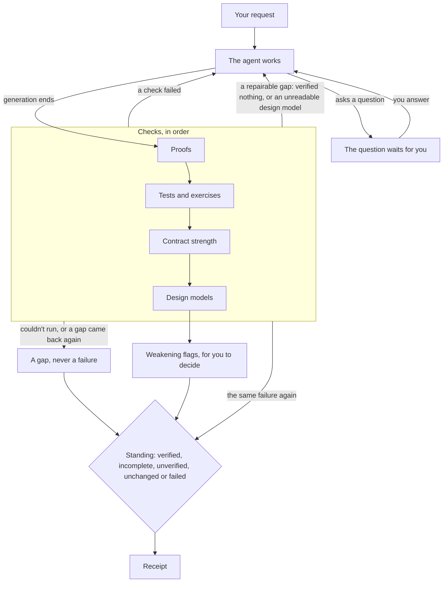

# How verification works

Suppose you ask Tesota to fix a calculation and add a test. When the agent
finishes, Tesota runs the project's checks. If they pass, it also tries
the changed test on the starting code to see whether the test notices the
change. The receipt keeps those results separate: a passing test and a
test that detects the change establish different things.

Verification is part of every run's lifecycle. It checks observed results;
[permissions](../guides/permissions.md) control which actions may run.
A receipt records evidence and its limits. You decide whether to accept
the change.

A run's cycle: failed checks and repairable gaps go back to the agent, and the gaps that remain reach the receipt.

## Evidence kinds

| Kind | What it establishes | Main limit |
| --- | --- | --- |
| Proof | The checked contracts hold for every admitted input in LemmaScript's model of TypeScript, as checked with Dafny | The contract may omit something you wanted, and the model differs from JavaScript runtime semantics |
| Project checks | Your project's selected commands passed | A passing command establishes only what it checks |
| Test exercise | A changed or added test fails on the starting code and passes with the change | The test's expected result may be wrong |
| Contract strength | Small changes to a function's body are rejected by its contract, apart from changes proved equivalent | Only the generated mutations were tried |
| Design model check | The declared properties hold in every reachable state of the design model as configured; planted-fault results are recorded separately | The design model can leave out behavior the code has |

Two additional checks use a model's judgment. ClaimCheck compares contracts
with your request. Open cases list inputs your request may leave ambiguous.
They appear separately in the receipt and do not count as check evidence
or decisions required by the receipt.

## Change scope

Tesota records the starting commit or snapshot before the agent works.
In a Git repository, it captures `HEAD` and dirty paths' content at the
first tool call that may change files, then captures them again at the end.
Changes include commits made during the request, deletions and untracked
files. A commit cannot hide a file from verification.

These observations describe changes during the request, whoever made them.
Files already dirty whose content stayed the same are inherited changes.
They are excluded from the request's proof and exercise scope, but project
commands still run with them present.

Contribution attribution asks which observed changes can be credited to
your request. It uses the starting and ending captures and Git history.
If those facts cannot establish credit, Tesota still checks the resulting
files, but omits measurements that need a reliable starting point.
[Receipt v2](../receipt-v2.md#capturestate) owns the exact attribution rules.

Unreadable captures and files too large to hash leave gaps in what Tesota
can observe. They cannot establish that nothing changed. Weakening checks compare the diff with the request's
starting commit, including inherited changes.

Outside Git, Tesota can take a private snapshot without adding a Git
folder to your workspace. It excludes `.env` and `.env.*` files, ignored files, dependencies
and build output. It refuses home folders, drive roots and folders beyond
its size or reading limits; the receipt explains what it could not verify.
A folder containing several repositories is checked in separate units.
Each unit is a repository or snapshot folder with its own starting commit
or snapshot, commands and evidence.

## Check order

Verification starts after generation ends. It needs a started tool call
that may change files and an observed change. Built-in readers and native
questions do not make a run eligible. A read-only session does not verify
another session's edits in the folder they share. The `prove` tool, which
checks one file's LemmaScript contracts, does count: it regenerates proof
files.

For eligible changes, Tesota proceeds in this order:

1. Prove changed TypeScript files with LemmaScript annotations, including
   sources whose generated or hand-written proof files changed.
2. Run the commands selected for the projects that own the changed files.
3. Measure new or changed contracts in files that proved, and compare them
   with the request.
4. Check affected design models, including their planted faults.
5. List open cases, check that evidence still matches current content, and
   publish the receipt.

A failure can return the run to the agent before later checks start.
Weak contracts also go back for repair. Once no check needs another repair
attempt, the receipt records what passed, failed or could not run.
An unresolved blocking question ends generation, but verification still
checks the changes and records the question.

### Repair attempts

A failed or vacuous check goes back to the agent unless the same failure
has already gone back during this request. A repeated failure is recorded
as no progress. Tesota compares proof output, failing test names when
available, surviving mutations, or design model counterexamples as
appropriate. A command without test reports gets one repair attempt.

A check that cannot start, exceeds its time limit or is cancelled does
not go back for automatic repair. The receipt leaves that limit for you.
The engine allows up to 32 automatic continuations per run, shared by
verification send-backs and extension requests to continue. Your input and
tool calls do not use that allowance.

## Proofs and contracts

Tesota runs LemmaScript in your project. Regeneration merges the changed
source into its Dafny proof while preserving hand-written proof additions;
checking then asks Dafny to verify it. Each process has five minutes.
A clean exit that verifies no obligation is vacuous and earns no proof.

By default, LemmaScript keeps a file's `.dfy` proof beside its TypeScript
source. A `proof-dir` in `lemmascript.json` places proofs under that folder,
mirroring source paths relative to the configuration file. When a `.dfy`
or `.dfy.gen` changes, Tesota looks for its source beside the proof and
through those configured paths, then confirms the mapping with `lsc config`.

The agent can use `prove` on one file while it works. The same verification
runs again at the end where needed. The tool is exposed when Tesota finds
LemmaScript annotations, including ones the agent writes.

A proof is conditional on its assumptions. Tesota identifies trusted or
excluded code, such as `//@ assume`, `//@ extern`, `//@ skip`, selective
`//@ verify` annotations and hand-written Dafny axioms. A proof with these
limits is shown with qualifications rather than as an outright proof.
Malformed annotation lines are reported so the agent can correct them.

### What a proof covers

A proof holds in LemmaScript's model of TypeScript. It does not establish
all behavior under JavaScript's runtime semantics. The receipt shows this
limit under each proof in its details.

- Numbers use mathematical integers by default, or exact reals for
  non-integer literals with Dafny. For example, `0.1 + 0.2 == 0.3` proves
  with exact reals but is false in JavaScript. The model has no 53-bit
  precision bound and no representation for `NaN`, `Infinity` or `-0`.
  Supported bitwise operations use unbounded arithmetic without int32 wrap.
- Only the supported TypeScript subset is represented. True `async`/`await`
  is unsupported; an `async` function without `await` can be checked.
  Class inheritance and mutation outside the supported subset are not
  covered. Class-field mutation can need hand-written Dafny proof additions.
  `**`, `>>>`, `Math.round`, `Math.trunc`, `Math.sqrt` and `Math.pow` have
  no lowering to the proof language.
- Coverage depends on which functions are extracted. With `//@ verify`
  in a file, only opted-in functions are checked. Without it, LemmaScript
  extracts all top-level functions by default. Class methods require
  `//@ verify`. Skipped or trusted code remains a limit.

See the [LemmaScript specification](https://github.com/midspiral/LemmaScript/blob/main/SPEC.md),
especially the type mapping, selective verification and unsupported features.

### Contract strength

After project commands no longer request a repair, Tesota tries up to eight small mutations per
new or changed top-level function contract. Examples include changing a
comparison, a returned value or an arithmetic operator. A mutation that
still proves is a survivor: the contract allows that behavior.

Dafny then checks whether each survivor returns the same result as the
original function for every admitted input. A proved-equivalent mutation
does not count against the contract. Other survivors make the contract
weak and send it back for strengthening while keeping it provable.

ClaimCheck makes two separate model requests. One restates the contract
without seeing your request; the other compares the restatement with your
request. Its judgment can help you review a contract, but cannot establish
that the contract expresses your intent.

## Tests

Tesota selects commands from the projects that own the changed files.
[Verification](../guides/verification.md) owns the command-selection table
and setup instructions. Each command has fifteen minutes.

After the commands pass, changed or added test files can run against the
starting code in a temporary Git worktree. Supported direct Bun, Vitest
and Jest scripts run the selected files; otherwise Tesota uses the
project's whole checks. Reports must show that the selected tests actually
ran. When a file filter also selects other files, the receipt says so.

A test earns exercise evidence only when it fails on the starting code
and passes with the change. If the starting project already fails,
per-test reports can distinguish newly failing tests from existing failures.
The checking command must also pass with the whole change in the same
worktree environment. Missing ignored dependencies must not masquerade
as a defect the change fixed.

A test that passes on the starting code does not depend on the change,
though it may still prevent a regression. Unknown results stay unknown.
Dependency manifest or lockfile changes prevent a reliable baseline
comparison. Inherited changes can also affect the comparison.

## Design models

A TLA+ or Quint design model describes states and steps, such as workers
competing for a lock. TLC explores every reachable state of the configured
finite design model. A passing check establishes that the declared
properties hold in every reachable state of that design model as configured.
Its constants, state constraints or a depth limit determine the bounds;
TLC is not inherently a bounded checker. The `tesota-model` header names the covered code, invariants,
atomic steps, omissions and planted faults.

Tesota checks a design model when the request changes its files, faults
or covered code. A passing session check can be reused for the same
content. Declared planted faults test whether the design model detects bugs. A
fault that passes, or cannot be read, makes the combined check fail.
An unfinished fault leaves a gap even when the main check passes.
A design model with no fault earns no passing evidence.

The agent's `check_model` tool uses the same checker while it works.
Counterexamples return as numbered steps. The agent must compare them
with the code: possible steps indicate a code defect; an impossible step
indicates an inaccurate design model. Weakening an invariant would hide
the problem.

The receipt states the design model's omissions, whether it was written
with the code and whether covered code differs from its confirmed commit.
A successful declared replay command links the design model to the code;
without it, that connection remains unverified. See
[Model checking](../guides/model-checking.md) for setup, headers and model
graphs. A model graph visualizes explored states; grouped transitions are
not an execution trace.

## Weakened evidence

Fixed diff rules flag changes that may weaken checks. Examples include
removed contracts, new preconditions on existing functions, added
assumptions, excluded proof code, deleted tests and changed check scripts.
Test-edit analysis can name removed or loosened assertions, skips, focused
tests and mocks in JavaScript and TypeScript using the conventions Tesota
parses, including Bun, Vitest and Jest. Other frameworks and languages get
the file-level weakening flag without per-test detail.

These are review flags. A legitimate change can trigger one. The rules
also miss some weakening, such as an early return added inside an existing
test. They do not establish that unflagged tests remain equally strong.
If the diff is too large to read, the receipt says weakening was not checked.

## Open cases

The open-cases lister reads your saved request messages, without the
agent's change or access to referenced files and URLs. It asks which
inputs could reasonably have more than one expected result. Missing
reference contents produce a reason instead of guessed requirements.

The configured default is `openai/gpt-6-sol`; you can choose another with
`--open-cases-model` or disable listing with `off`. This is a configured
choice, not a demonstrated launch-performance claim. If the model is
unavailable or exceeds two minutes, the receipt records why no list was
produced. Its suggestions remain a model's opinion for you to review.

## Standing

The receipt derives a standing from its evidence and findings. A receipt
stands `failed` only when a check ran and showed the change wrong: a
failing test, a proof that doesn't hold, or a design model with a
counterexample or a planted fault it didn't catch. A check that couldn't
run, ran past its limit, was stopped, checked nothing, couldn't be read or
is stale is a gap: the run is incomplete, or unverified if nothing else
passed.

| Standing | Meaning |
| --- | --- |
| `failed` | A check ran and showed the change wrong |
| `incomplete` | The run stopped or needs a decision without a failed check; or evidence passed but gaps or uncovered paths remain |
| `unchanged` | Nothing changed; print mode says “Completed (nothing to verify)”, while other surfaces say “nothing to verify” |
| `unverified` | Something changed and no proof, command or design model check passed on current content |
| `verified` | Evidence passed, every changed path is covered, no other gap or decision remains, and the run was not stopped |

Coverage means a path proved or was tested and exercised under the
receipt's conservative matching rules. Test files and comment-only changes
are excluded from the unproved-file list. Changed lines outside proved
contracts are still listed. With several unproved files, exercise evidence
cannot establish which implementation file a test exercised.

[Receipt v2](../receipt-v2.md#standing) specifies the exact interpretation.
Tesota's own pure decisions are listed in [Proved rules](../reference/proved-rules.md).

## Evidence limits

Evidence records the checker, outcome, output, duration and a content hash
of its listed files. Before publishing, Tesota invalidates evidence whose
content changed. It preserves the checked hash and output but cannot
claim a pass on the current files. It does not automatically retry.
Export rechecks proof, command and design model evidence and compares
recorded file blobs with the commit. It refuses whenever the commit
doesn't hold exactly what the checks saw. Exported as a Statement, a
`verified` or `unchanged` receipt states `COMPLETED`, a `failed` one
`FAILED`, and a stopped run's `CANCELLED`. An `incomplete` or `unverified`
receipt isn't exported, because no defined result states it truthfully;
read it with `tesota receipt`. See [Receipt v2](../receipt-v2.md).

Hashes are not an atomic snapshot. Another writer can change files after
a read. Command hashes cover changed paths rather than every dependency
a command reads. A passing check can therefore establish less than a
reader assumes. Proof coverage also depends on the written contract;
a design model covers only its declared abstraction.

## Stops and recovery

A waiting question has no time limit. It stays pending until you answer,
dismiss it or stop the run.

Stopping during verification interrupts the active check and its child
processes; no later check starts. The stopped receipt claims no evidence.
It lists changed files through a read-only inventory, or says the inventory
was unreadable. That inventory has a thirty-second limit.

If the process dies, it cannot publish a receipt at that moment. Reopening
the session records the interrupted run once. If a started call may have
changed files, recovery adds a receipt that verified nothing and says the
change is unknown. Files present when you reopen are not claimed to be
what the interrupted run left.

Recovery marks unfinished read-only calls as having no effect, other
started calls as outcome unknown and unstarted calls as not run. It does
not replay calls or unsaved answers. A new request can verify the current
content. A session never reopened after a killed process gets no recovery
receipt.
