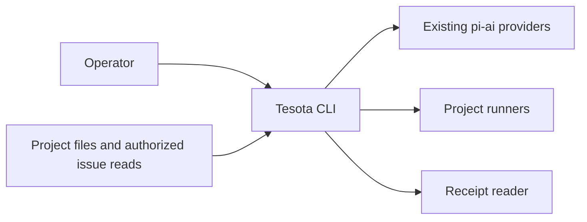
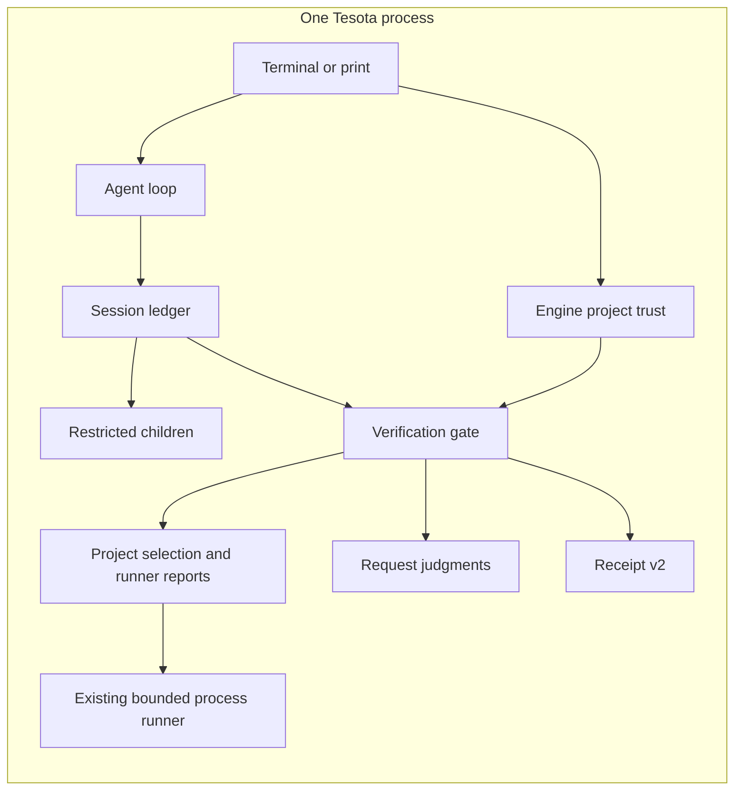

# Project checks and shared issue context

**Status:** Proposed design; implementation requested. The operator approved
GitHub CLI capture and additive receipt-v2 provenance, and directed a clean
internal refactor. Human acceptance of the implementation remains separate.
**Baseline:** `4bbaef98`. **Scope:** [#728](https://github.com/sequelcore/tesota/issues/728),
[#753](https://github.com/sequelcore/tesota/issues/753),
[#637](https://github.com/sequelcore/tesota/issues/637).
The [ADR](2026-11-01-checks-context.md) records the decision.

## Question and constraints

How can the existing CLI retain useful test evidence and give judging roles
the issue text the parent read, while keeping execution authority in code?

Tesota remains one client-operated CLI. Its engine owns permissions, trust and
the append-only session ledger. Verification owns checks and receipts, through
the existing host contract. No service, database, verifier, new model route or
automatic issue-fetch authority is needed. These constraints come from
[the roadmap](../../ROADMAP.md), [architecture](../concepts/architecture.md),
[development](../development.md) and [configuration](../reference/configuration.md).

## Requirements and budgets

| Requirement | Bound or invariant |
| --- | --- |
| Failure attribution | Same named failures on a faithful base stay from repair; new failures return; unexplained runner failures remain unknown |
| Runner support | Plain Bun, Vitest and Jest scripts; unsupported composites retain unknown attribution unless their own reports establish it |
| Declared checks | One checkout-level declaration, independent command working folders, optional timeout and JUnit report |
| Execution authority | Current operator trust of the exact declaration bytes, rechecked before each command, including base comparisons |
| Configuration size | 64 KiB, 1–32 commands, at most 8 KiB per command |
| Check timeout | 1–900 seconds; 900 by default |
| Reports | Existing 16 MiB per-file parser limit; declared report paths remain confined and are cleared before execution |
| Issue context | At most eight context entries and 128 KiB of complete returned text; excess becomes an explicit gap |
| Judging context | Whole request/reference groups must fit the complete prompt and output reservation |
| Concurrency | Existing child depth two and default four concurrent children across the tree |
| Compatibility | Installed Bun 1.4.2, Node 24.15.0 and Dafny 4.11.0; existing release targets and budgets remain |

Configuration and reference caps are design choices, not measured workloads.
User count, request rate and retention growth are unknown; this work adds no
server or availability SLA. RPO remains the synced ledger boundary, subject to
filesystem durability. Unsynced output has no durability promise. RTO is session
reopen; a wall-clock target is unknown. The operator owns local backups; this
work makes no tested-restore claim.

## Context and containers

## Owners and flows

`projects.ts` owns check selection and the normalized command contract: command,
execution folder, timeout, report paths and discovered-script metadata. Ownership
of changed paths remains separate from execution folders. Declared checks apply
to the whole checkout and replace discovery. `project-checks.ts` owns bounded
parsing and approval checks. Shared `checkout-root.ts` resolves the same root for
startup, verification scopes and base worktrees. Engine `trust.ts` owns approvals; verification asks
through `HostParts` and never imports the engine.

The terminal shows the commands before recording trust. Print and child sessions
cannot grant it. The gate carries an immutable selected plan, revalidates its
original checkout's current declaration and trust, and independently confines
paths against the execution root. Base worktrees reuse that approved plan;
their temporary paths cannot grant themselves trust. A changed declaration
cannot establish faithful base attribution or exercise credit.
Before borrowing installed dependencies, declared checks compare tracked and
untracked dependency inputs across the checkout against the base, including
changes outside a nested verification scope. An unreadable comparison stays unknown.

`test-rung.ts` owns execution and reuses its runner probe for whole checks and
per-file exercise. Whole checks do not gain empty-suite success. Generated
reports are fresh, private to the invocation, and use the same relative identity
on both revisions. The receipt keeps the selected command's readable identity
and records the reporting invocation in output. Unsupported scripts keep their
existing behavior.

JUnit alone cannot establish completeness for Bun: a live 1.4.2 run with an old
assertion failure and a new import error omitted the import-error suite from its
XML. Attribution therefore also accounts for Bun's failed-result summary and
error count. Jest runtime-suite and snapshot failures outside assertions make
its report unusable for attribution. Missing or incomplete results never mean
pre-existing.

`issue-context.ts` resolves the identity of a supported plain `gh issue view`
when the already-authorized native shell executes it. Explicit repository
arguments, `GH_REPO` and a bounded local `gh repo set-default --view` query resolve
the CLI's effective repository; no origin guess or judging-role fetch is used. Metadata
is stored beside the exact returned tool text. Ledger derivation selects only
issues named by the request and binds repository, issue, call ID and text digest.
Partial JSON, custom templates, pipelines and truncated output remain gaps.
Initial support is GitHub.com CLI reads; MCP and arbitrary scripts are outside
this implementation.

`request-references.ts` owns the separate third-party context envelope. Child
spawn carries it separately from the brief; the session records it as custom
data and restores it independently through compaction and resume. Grandchildren
retain that distinction. Request judgments receive whole snapshots separately
from operator text; ClaimCheck's blind restatement stays blind. Receipt-v2
provenance contains identities, digests and gaps, not another copy of issue text.
It never changes standing, repair, permission or acceptance. Absent historical
metadata means unknown provenance; no reconstruction or compatibility layer is
introduced.

## Failure, security and recovery

Malformed declarations, changed or revoked trust, missing folders and unsafe
report paths produce not-started evidence. No fallback runs a smaller discovered
check set. Declared paths reject traversal, absolute names, `.git` and links.
Generated report cleanup is awaited; old or linked reports give no evidence.
Timeouts do not rerun on the base. Existing Effect/process ownership awaits
cancellation and process-tree cleanup.

Issue content may contain prompt injection. It remains labeled third-party data
and grants no engine authority; labeling is not proof of model resistance.
Snapshots may reach the already-selected role providers but are never published
automatically. A successful CLI read and digest establish what was returned,
not the source's authenticity or correctness.

No session migration or additional persistent service is needed. Rollback uses
the previous binary and removes the new declaration if desired. Existing receipt
semantics remain documented at their published path. No project or session
cleanup is automatic.

## Capacity

Configuration reads are at most 64 KiB per lookup. Parent plus four children copy
at most `5 × 128 KiB = 640 KiB` of reference text, excluding framework and prompt
overhead. The existing tree-wide concurrency cap also counts grandchildren.
At roughly 1 KiB per bounded provenance entry, eight entries in two judgments
add approximately 16 KiB per run, excluding existing tool output. For `R`
retained runs per year, that is approximately `16 KiB × R` after one year and
`48 KiB × R` after three. `R`, retention and actual provider overhead are unknown.
The release-binary budgets check startup, resume, loop and shell effects.

## Alternatives and review

| Option | Result |
| --- | --- |
| Extend existing selection, trust, probes and ledger | Chosen: one owner per behavior and no additional authority |
| Generic check plugins and issue-fetch service | Extra contracts and lifecycle without a current consumer |
| Full parent-history inheritance | Larger prompts and disclosure of unrelated context |
| Parent-written issue summaries | Retains the missing-source failure reported in #637 |

The independent architecture review identified three failures: assertion-only
reports can hide runner errors; flattened child briefs lose provenance; base
worktree paths cannot establish the original checkout's trust. The design
incorporates all three corrections. It also adopts one command object per
invocation and records the operator-approved CLI-only capture scope. Review is
not behavioral evidence. Implementation review also reproduced wrong GitHub
default-repository attribution, ignored root declarations from nested scopes,
shared repair history for duplicate commands, and contradictory inherited
reference gaps. Regression tests cover the corrections: CLI-owned repository
resolution, one checkout-root owner, per-declaration invocation identity, and
matching inherited canonical sources before recording a gap.
Follow-up review also reproduced a dependency change outside a nested scope;
the shared base guard now inspects the checkout boundary for both attribution
and exercise credit.

Reference inspection on 2026-11-01 used local clones and current primary runner
documentation. Codex's [spawn implementation](https://github.com/openai/codex/blob/f2ac9983552d187aa1c9a53c4707cf3b2c4afde6/codex-rs/core/src/tools/handlers/multi_agents/spawn.rs)
offers full-history inheritance; that is broader than this need. Gemini's
[trusted hooks](https://github.com/google-gemini/gemini-cli/blob/b633c0703417eff3f6db8b684515e2b26a824e82/packages/core/src/hooks/trustedHooks.ts)
bind approvals to project command definitions; Tesota retains its own existing
root-and-content-hash policy. The clones date from October 30 and 29 respectively;
this is a focused comparison, not a claim to have surveyed all current harnesses.
[Bun](https://bun.sh/docs/test/reporters), [Vitest 4](https://v4.vitest.dev/guide/reporters)
and [Jest](https://jestjs.io/docs/cli) document the reporting flags. No new runtime
dependency or copied third-party implementation is introduced.

## Delivery and verification

Implement report attribution, then declared-check trust/execution, then shared
issue context. Each slice begins with a failing regression or bounded live
reproduction. Check real runners, base comparisons, stale/linked reports,
declaration changes, trust revocation, terminal and print behavior, restricted
children, capacity, resume and compaction. Prove the report-accounting,
declaration-authorization and reference-budget rules, including rejected mutants.
Run `bun run check`, `bun run formal:check` and `git diff --check`; capture the
terminal trust path with its viewport and interaction. These checks do not
establish human acceptance, arbitrary-runner completeness or general
prompt-injection resistance.

Unresolved operator questions: none for implementation. Human acceptance and
shipping remain separate decisions.
