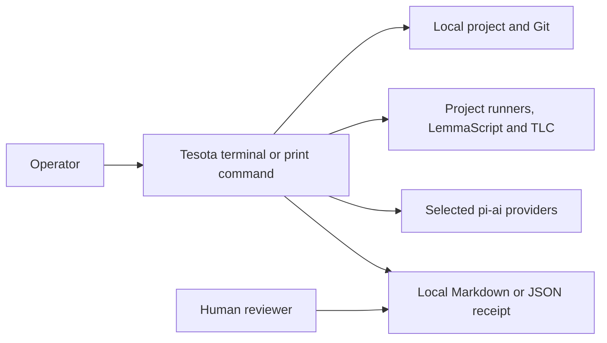
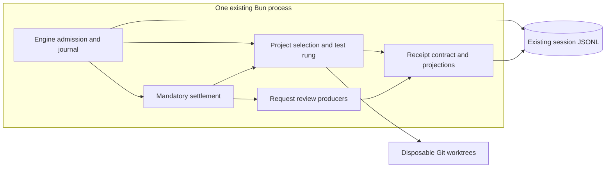

# Request checks, source exercise and receipt v3

**Status:** Proposed; implementation requested, human acceptance pending.
**Date:** 2026-11-02. **Baseline:** `d0f72852` on `dev`.
**Work:** [#727](https://github.com/sequelcore/tesota/issues/727),
[#669](https://github.com/sequelcore/tesota/issues/669),
[#731](https://github.com/sequelcore/tesota/issues/731).

## Decision and scope

Retain admitted checks, measure which source changes tests notice, and separate
mechanical evidence from request review. Extend existing owners; add no service.

The operator approved recording and showing checks before work, comparing the
base at settlement, at most two additional minutes per repository for source
exercise, and one live Sol/Luna comparison through the existing sign-in capped
at twenty minutes total. No API-key purchase is authorized. Alpha has no external
consumers: replace internal contracts cleanly; add no v2 adapter or dual writer.

Excluded: continuous checking after edits, flaky-test detection, benchmark
claims, automatic publication, native reviewer orchestration, screenshots as
verification, a new sandbox, and dependency/parser upgrades.

## Requirements and constraints

| Requirement | Bound or source |
| --- | --- |
| Consumers | Existing terminal, print mode, session resume, child summaries and receipt export |
| Concurrency | One writer per session; current tree-wide child limits remain unchanged |
| Admission | Read the check plan once before the first model call; do not run suites upfront |
| Attribution | Compare the same admitted invocation on base and change; unknown never becomes pre-existing |
| Source exercise | Sequential probes; at most 120,000 ms extra per repository, including setup and confirmation |
| Check timeout | Existing per-command timeout; source probes also obey their remaining shared budget |
| Model reviews | Existing five-minute ClaimCheck and two-minute open-case limits |
| Project discovery | Existing depth-three discovery and declaration/trust limits |
| Performance | Keep every existing `packages/core/budgets.json` limit unchanged |
| Durability/RPO | Admission data appended before model work; current journal sync/crash guarantees, no stronger RPO claim |
| Recovery/RTO | Existing interrupted-run inventory on resume; recovery latency is not separately measured |
| Availability | Local CLI; no new network dependency for mechanical evidence |
| Operation | User operates the CLI; Sequel maintains releases and schema documentation |

Sources: [development](../development.md), [architecture](../concepts/architecture.md),
[receipt v2](../receipt-v2.md), `packages/core/src/session-file.ts`,
`src/project-checks.ts`, and the approved preceding
[checks/context decision](2026-11-01-checks-context.md). Current code takes
precedence over older issue descriptions: restatements and reference provenance
already exist, and #789 already improved runner reports and declared checks.

## Context and deployment

No PostgreSQL is introduced: there is no shared server state or second process
requiring it. Local append-only session storage already owns this lifecycle.

## Ownership and flow

### Admission and command identity (#727)

`projects.ts` remains the discovery and ownership owner; `project-checks.ts`
remains the declaration and trust owner. Capture an immutable, serializable
check plan for each existing workspace unit at request admission. The plan
retains command, folder, timeout, runner/report contract and declaration
identity, together with why selection was unavailable. Bind it to the request's
base. Session storage owns durability, not discovery policy.

Present the plan to the model as clearly labeled execution context before its
first call and retain it through compaction and resume. It is neither an
operator instruction nor a command execution grant. Show the same plan to the
operator. The gate selects owning projects from this captured plan after it
knows changed paths, rather than discovering a different plan at settlement.
New project scopes absent at admission remain explicit gaps; they are not
silently invented as baseline checks.

Every execution still checks current trust and path confinement. A changed
declaration invalidates authorization; a changed script or environment cannot
be called a faithful baseline. Existing dependency-change guards remain. Keep
base/change command outcomes and report-based attribution in the receipt,
including introduced, pre-existing, fixed and unknown where observed. Do not
infer fixed failures when no comparable base run exists. No base retry for a
timeout. Identical unstructured output is insufficient evidence of identical
failures. Unknown failures remain visible and follow the existing repair rule.

### Source exercise (#669)

`test-rung.ts` owns process orchestration and the counterfactual measurement;
the proved standing rule owns how recorded credit affects standing. Existing
whole-base test sensitivity and per-source exercise are distinct facts.

Use the existing disposable base worktree and dependency/configuration guards.
Materialize the complete candidate, run the owning project's supported targeted
runner on changed tests and require a real passing report. Then restore one
changed source path to its base content, leaving all other candidate files and
tests intact, and run the identical probe. Record only tests with newly failing
reported assertions from that probe as noticing that source path. Restore the
complete candidate before every next probe; never mutate the user's checkout.

Do not grant credit for a missing import, runner error, empty suite, skipped
test, timeout, unavailable base, changed dependencies, stale candidate or
unreadable report. Added source paths may consequently remain unmeasured when
their removal only prevents loading: do not turn that limitation into coverage.
Unsupported runners and declared composite checks keep their existing test
sensitivity evidence but receive no invented per-source credit.

Store measured source paths on the exercise record, with explicit gaps and
reasons for attempts that cannot establish credit. A path is tested/exercised
only when a current passing command and a successful path-specific measurement
support it. A successful measurement for another path gives no credit. A
non-noticing unrelated test does not erase another test's measured credit.
Content identity and request attribution must still hold at settlement/export.

The shared 120-second deadline starts before source-exercise worktree setup,
includes the candidate control and all probes, and is never reset on retry.
Cancellation and expiry stop measurement and await process-tree cleanup. Git
cleanup has its own bounded attempts and can exceed the measurement deadline.
Remaining paths explicitly
stay unverified. Ordinary existing exercise is not granted a fresh unbounded
source-probe allowance for each test or project.

### Canonical receipt and request review (#731)

`receipt.ts` owns version 3. Existing producers return their own results;
renderers project the stored contract rather than reclassifying it. Group
mechanical code records under `codeEvidence`, mechanical strength/weakening
under `specificationEvidence`, and model output under `requestReview` with
`kind: model_opinion`. Preserve run, checked-content, change inventory,
workspace-unit, external-effect and stale-evidence identities. Keep one record
per observed proof; specification findings reference its vacuity result.

Remove judgments/restatements from `ContractStrength`. Request review keeps each
eligible changed contract's unit, path, function and checked contract content,
literal first-pass restatement and optional assessment. Retain successful first
passes and individual assessments even when later work fails. Record actual
attempted models, failed stage, completed/partial/not-run status and reasons.
Use `no_mismatch_identified`, `partial_match`, `mismatch` and
`suspected_vacuity`; none is mechanical evidence.

Retain original operator messages and submitted clarifications in request
context. Each model stage records the exact whole request messages and
third-party references actually supplied, with capacity omissions and reasons.
The blind restatement explicitly received no request context. Open cases have
their own context and distinguish listed-empty, disabled and unavailable.
Disabled/missing-model/no-contract/cancellation paths still produce an explicit
review summary; absence never implies agreement or whole-request coverage.

Terminal, Markdown and JSON share these meanings. Show request context, code
evidence, specification evidence and an always-visible request-review summary.
Name the mechanical summary `Evidence standing`, label the separate section
`Request review — model opinion`, and close with `Acceptance remains with the
reviewer.` Model opinions must not affect standing, required-decision counts,
send-backs or continuation, including when a mismatch accompanies all passing
mechanical checks.

New sessions write v3 only. Export uses the v3 predicate URL after its reference
exists. Unknown/old versions get an explicit unsupported-format result;
historical v2 JSON remains readable against its preserved v2 reference. Do not
rewrite old session files, reconstruct missing prompts, or add migration aliases.

## Consistency, failures and security

Admission precedes model work and the journal records it once per request.
Continuation restores the same plan; a new request captures a new one. Repair
rounds reuse the request plan and budget, not newly discovered commands.
Worktree mutations are sequential and cleanup is awaited, including exceptions.
Failed setup, cancellation or unreadable state yields gaps, never a pass.

Commands and repository content remain untrusted. Capturing them grants no
authority beyond existing project trust and process execution. Source exercise
executes only an existing supported runner; it does not synthesize shell code
from model text. Existing OS-process handling and original-checkout approval
checks remain. Request text already reaches session/export consumers; no new
publication path is added. Do not log credentials, home paths or sign-in state.

Rollback uses the previous binary and preserved source checkout. New v3 sessions
cannot be rendered by old binaries; retain their JSON rather than claim backward
compatibility. Session backup/restore uses existing file copies; no managed
backup or tested restore guarantee is added by this change.

## Capacity and alternatives

The check plan adds serialized invocation metadata once per request, not per
model turn. If its measured size is `C` bytes and a user retains `R` requests per
year, growth is `C × R` after one year and `3 × C × R` after three. Both actual
`C` was 133 bytes in the controlled live fixture; user retention `R` is unknown.
Request-review storage is proportional to the context actually supplied, bounded
by existing model capacity and reference limits. Source probes add at most 120
seconds per repository and run sequentially; test/source cardinality increases
unmeasured paths rather than the allowance. No new parallel worker is added.

| Option | Consequence |
| --- | --- |
| Capture plan early; compare at settlement; targeted source reversions; one v3 contract | Chosen: avoids unconditional startup checks, provides path-specific evidence and a structural opinion boundary |
| Run all baseline suites eagerly; use runner coverage for path credit; keep v2 fields with labels | Viable but adds upfront latency; execution coverage does not show assertion sensitivity; nested opinions remain structurally ambiguous |

Tradeoffs: no baseline results before coding; incomplete credit for unsupported
runners and source additions that cannot load when absent.

## Reference investigation (cutoff 2026-11-02)

Bound: two local harnesses and the installed runners' primary reporting docs;
stop when they answer the integration questions. Codex clone `f2ac9983`,
`codex-rs/core/src/tasks/review.rs`, has a separate review task and review-output
protocol. Gemini clone `b633c070`,
`packages/core/src/prompts/snippets.ts`, instructs agents to identify and execute
project checks. Neither inspected surface establishes recorded baseline failure
attribution or test-to-source sensitivity. This is a scoped observation, not a
claim that those products lack such capabilities. Their local revisions were
inspected without changing the clones; current upstream behavior is unverified.

[Vitest v4 reporting](https://v4.vitest.dev/guide/reporters) and
[Jest CLI](https://jestjs.io/docs/cli#--runtestsbypath), inspected on the cutoff,
support explicit machine-readable reports and targeted tests. Tesota retains
its current runner probes and validates them with real processes; no new
reporting dependency or copied harness code is needed.

## Independent challenge and delivery

Independent architecture review found that a named JUnit failure may be a
setup TypeError with no assertion reached. A real Vitest fixture reproduced
that failure. Source credit now requires a classified assertion failure in a
previously passing named test, with passing candidate controls. The reviewer
also identified unbounded worktree setup: setup now shares the measurement
deadline; cleanup is awaited separately. Final review reproduced false source
credit from inherited dirty files, ignored local inputs and oversized base
blobs. Unfaithful candidates now receive gaps; ignored inputs are never copied,
except dependency directories actually borrowed; confirmed absence is distinct
from an unreadable blob. Regressions failed before each correction and passed
afterward. Workspace projection now preserves every unit's model assessment.
Review is not behavioral evidence.

### Bounded live observation

Four registered runs used identical Pi fixtures at upstream `be15fe3c`, one
seeded legacy failure and existing sign-in. The task added CRLF normalization
to its surrogate sanitizer. Total time: 146.6 seconds within twenty minutes.

| Model and arm | Seconds | Total tokens, including cached | Model calls |
| --- | --- | --- | --- |
| Sol baseline | 44.3 | 23,436 | 7 |
| Sol candidate | 54.9 | 27,445 | 8 |
| Luna candidate | 18.9 | 18,109 | 6 |
| Luna baseline | 28.4 | 20,013 | 7 |

All four exited successfully, passed five independent behavior/preservation
checks, reported the seeded failure as pre-existing, and required no repair
round. Candidates retained the admitted invocation and explicit baseline
outcome. Verdict: diagnostic-only; no model ranking or improvement follows.
Baseline was `d0f72852`; frozen candidate binary SHA-256 began `4d49e23dbdbe7596`.
Later review corrections were checked separately; this was not a live run of
the final tree. Raw sessions, patches and identities remain in session scratch.

Delivery checks cover admission/resume, trust/nesting, path credit and gaps,
deadlines/freshness, review retention and opinion-independent standing.
Required gates: `bun run check`, `bun run formal:check`, `git diff --check`,
wrong-rule mutations, compiled smoke and terminal captures with viewport,
data and interaction. Passing checks support operator review.

No release, push, PR publication or issue closure is part of this authorization.
Unresolved operator questions: none for implementation; design and visual
acceptance remain with the operator.
