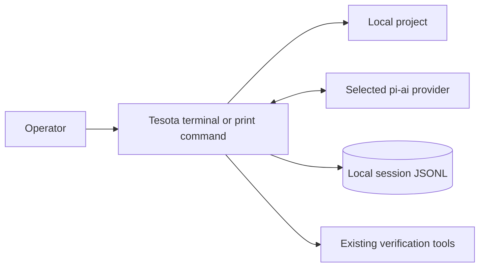
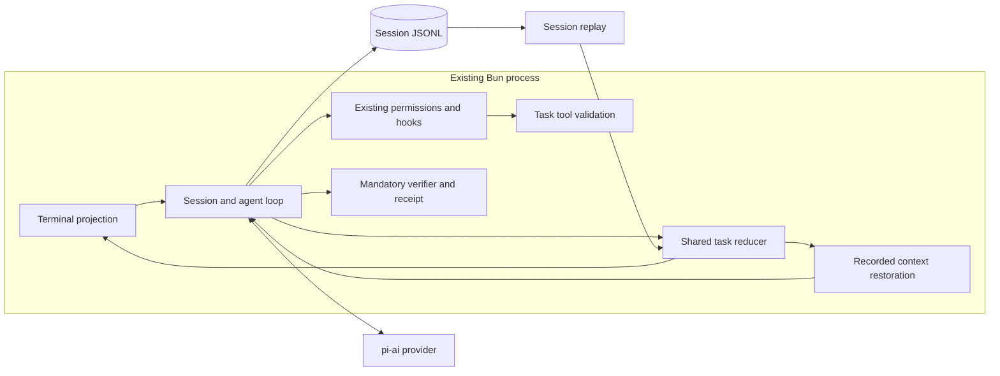

# A task list during execution

**Status:** Accepted by the owner on 2026-11-05; not implemented.
**Date:** 2026-11-05. **Baseline:** `2766d3a21d4868badbb34f45fddc3fa728be4019`.
**Work:** [#521](https://github.com/sequelcore/tesota/issues/521).
**Decision:** [ADR](2026-11-05-task-list.md).

## Purpose and scope

Show current focus and remaining steps. Preserve exact state through compaction
and session reopening; lists remain claims, separate from scope and verification.

Keep one list per request lineage: a request and its recorded continuations.
Exclude cross-session backlogs, dependency graphs, shared writers, item editing,
plan mode, receipt changes, and forced updates. Child sessions do not mutate the
parent's list. The parent can describe delegated work as an ordinary item.

Refactor alpha directly: no aliases, dual writers, adapters, or second store.
The session format stays at version 7: task state is derived from entries the
journal already records, so no entry changes shape.

## Requirements and bounds

| Requirement | Bound or source |
| --- | --- |
| Consumers | Existing terminal operator; model context after compaction; same-session resume |
| Concurrency | One writer per session; reply tool calls execute sequentially today |
| Ownership | One active list per request lineage; zero shared writers across sessions |
| Durability/RPO | Zero acknowledged list updates lost after successful journal sync, subject to existing filesystem guarantees |
| Recovery/RTO | No model call on reopen; restore with existing session replay; additional latency unknown until measured |
| Payload | 16 KiB for UTF-8 `JSON.stringify({tasks})`, 1,024 UTF-8 bytes per title; reject oversize input without truncation |
| Journal growth | The call's arguments hold the list; its result is a short acknowledgement |
| Latency | No additional model request per update or restore; one extra sync per accepted update; wall-time overhead unknown |
| Performance | Existing [engine budgets](../../packages/core/budgets.json) unchanged; measure enabled workloads separately |
| Availability | Local Bun process; no new service, network dependency, or authentication |
| Privacy | Same session storage and selected model providers; no automatic export or publication |
| Operation | Operator runs CLI and manages session retention; Sequel maintains releases |

Bounds are owner choices, not measured optima. Payload limits bound task count.
The
[roadmap](../../ROADMAP.md) still puts verification first.

## Existing owners and constraints

[Architecture](../concepts/architecture.md), [sessions](../guides/sessions.md),
[permissions](../guides/permissions.md), and [development](../development.md)
own runtime, recovery, authority, and release constraints. Keep pi-ai for model
access, pi-tui for drawing, and the existing session JSONL as the only store.
PostgreSQL, queues, and sidecar files solve no current requirement.

| Owner | Change and consumers |
| --- | --- |
| Engine task policy | One schema, validation, and pure entry reducer; tool, replay, context, and shell consume it |
| `tools/index.ts` and loop tool registration | Register a session-bound `update_tasks` tool when enabled; no extension or verifier ownership |
| `loop.ts` | Commit accepted results, preserve sequential order, include task state in compacted context |
| `session.ts` | Seed the same reducer during replay; resolve transitive continuation links |
| `session-file.ts` | No change; existing writer, validation, sync, and corruption handling |
| `shell/shell.ts` and `shell/transcript.ts` | Draw committed snapshots, using existing Ctrl+O expansion and terminal escaping |
| `settings.ts` and entry-point wiring | Boolean `taskList`, default false; top-level terminal and print use the same policy |
| Verification layer | No task-status input, evidence field, settlement shortcut, or receipt schema change |

Live updates and replay share one engine policy, importing neither shell nor
verifier. Session admission supplies the loop with resolved lineage and initial
state through a concrete internal callback; expose projection on EngineSession.
Add no event bus or storage port.

### Context and containers





## Tool and state contract

Tool input:

```json
{
  "tasks": [
    { "title": "Inspect session recovery", "status": "completed" },
    { "title": "Implement task restoration", "status": "in_progress" },
    { "title": "Check the real terminal path", "status": "pending" }
  ]
}
```

Statuses are pending, in_progress, completed, and cancelled. Reject multiple
in_progress items; primary focus does not describe background jobs. Zero is
valid. Require nonblank titles and valid statuses. Empty input clears the list.
Replacement may reorder, reword, or omit items; history remains recorded and
request obligations do not change. IDs and deletion rejection have no consumer.

The native result is a short acknowledgement with no details. A successful
result commits the list in its matching call's arguments; existing entries
already identify run and call. Intent, assistant text, failed calls, and context
notices commit nothing. Replay recognizes updates by the `update_tasks` name,
so extensions may not register it even when the feature is off; MCP names
already carry the `mcp__` prefix. The session layer follows transitive
`continues` links; latest means last successful result across that chain.
Reject missing, forward, or cyclic links as unavailable. Malformed task data
makes the projection unavailable, never empty or an older snapshot. A subsequent
valid full replacement restores availability; the tool remains usable.

The tool computes a candidate without mutating canonical state. For a task
result only, `runCalls.answer` calls `writer.sync()` after `writer.append()` and
before `add(result)`; other tool results keep their current durability. Only
then update the projection and notify listeners. If append or sync throws, the
session writer is poisoned: every later append and sync throws the same error,
so no contradictory result can be written. The run stops through that existing
path without retrying. Written bytes may survive despite a failed sync: replay
may show an unacknowledged update. No acknowledged success precedes durability.

`runCalls` is sequential: updates commit in call order. Identical replacements
produce identical state, with both calls recorded. Add no queue or lock.

## Request boundaries and restoration

| Boundary | Behavior |
| --- | --- |
| Amendment within a run | Keep ownership; the model reconciles its list with new input |
| Answer linked by existing `continues` data | Select latest snapshot along its ancestor chain, never siblings |
| Verification sends generation back | Retain list; task completion does not suppress repair |
| Stop, error, or crash | Preserve snapshot; display outcome separately, without rewriting item claims |
| Reopen session | Show saved snapshot; run nothing |
| New request without an explicit link | Start with no active list; old snapshots remain historical |
| Plain “continue” after a stopped run | Currently a new request; do not infer a link from wording |

The last rule is an accepted first-version limitation; explicit resumption of
a stopped run is [#823](https://github.com/sequelcore/tesota/issues/823). New requests may create
lists from visible history, but inherit neither scope nor verification base.

Compaction entries keep their current shape. The state a compaction restores is
derived from the journal entries before it: the latest successful result along
the run's ancestor chain, none, or unavailable. Live compaction and replay see
the same preceding entries and apply the same reducer, so both select the same
state. The full journal retains every commit.

Pass resolved state to `compactedHead` as a separately labeled, agent-authored,
unverified section, never operator instructions. Include that section in the
smaller-head check, `tokensAfter`, overflow reserve, and `/context` accounting.
Live compaction and replay use the same builder. A torn compaction record uses
existing recovery; nothing task-specific is recorded with it. If both the
selected call's matching arguments and successful result remain in the tail,
the section references them without repeating titles; otherwise it includes the
full snapshot. Restoration depends on the journal alone, never on the current
setting. Historical results grant no current scope.

Keep Progress and Open items in the summary: they carry evidence, decisions,
and unknowns. The request ledger governs scope, task state governs list metadata,
and checks govern verification. The builder derives what the model sees from
journal data; no provider-only injection is introduced.

At enabled admission, the session callback supplies ancestor lineage and state:
snapshot, none, or unavailable. When the state is a snapshot or unavailable,
record one internal `custom_message` naming lineage and state, after all
admission entries but before their sync; a request that inherits no list
records nothing. Add it after all admission messages live and on replay. It carries no scope authority
and stays outside the request ledger. Compaction replaces notices with its
current-state section. No periodic reminders, counters, gates, or auto-resumption.

## Terminal, permissions, and failures

Draw a compact row above the editor with primary focus and claimed counts.
Ctrl+O expands status words and titles using existing drawing conventions.
Use neutral or opinion styling, never verification green. Show “Agent task
list”; distinguish a live focus from a saved list using existing run outcome. Keep
questions, working status, and results outside the list. No ETA or percentage
claim. Narrow views wrap or clip visually without modifying saved titles.

Use `access: "read"`: no workspace effect, like the journal-writing question
tool. Persistence accepts no model-supplied path. Rules, hooks, and floor still
apply. Denial fails the call without changing state or blocking ordinary work.
Children omit the tool. Print records state without a tray.

| Failure | Detection and recovery |
| --- | --- |
| Invalid or oversized input | Failed tool result; prior state retained |
| Interrupted call before result | No new commit; existing recovery reconciles call |
| Disk or sync failure | Existing poisoned-session path; stop, do not acknowledge success |
| Corrupt journal | Existing refusal or torn-tail repair rules; no task-specific guessing |
| Lost or contradictory summary | Restore the derived snapshot with unverified label; retain request authority |
| Stale model claims | Operator can inspect transcript; no automatic correctness inference |
| Slow or failed provider | Existing retry and stop policy; list remains a saved claim |
| Shell failure | Rebuild projection on reopen; no effect on verification |

Escape titles as untrusted terminal data; never execute them. Restoration grants
no authority or proof of injection resistance. Retain current credentials,
network exposure, deletion, and retention controls.

## Capacity, release, and validation

One initial replay is O(entries); live updates are incremental. Retain only the
latest snapshot for each requested view, not another in-memory journal. An
illustrative 8 KiB snapshot appears once, in the call's arguments; assuming
2 KiB envelope overhead gives 10 KiB/update. Ten updates/day for 220 days gives
21.5 MiB/year, 64.5 MiB over three years. At 16 KiB plus 2 KiB overhead,
100 updates/day gives 0.378 GiB/year, 1.13 GiB over three years. Continuation
notices add another snapshot; compaction stores nothing new. Other transcript data is additional. These are workload estimates,
not storage ceilings. Retention and actual frequency remain unknown.

Full replacement costs O(items) per update. Context pays for historical call
arguments plus a current list after compaction; use `estimateTokens` against the
selected model's actual window, rather than assuming a bytes-to-tokens ratio.
If the complete compacted head does not shrink, follow the existing compaction
failure path without dropping tasks to manufacture room.

Ship through the existing alpha binary process. The default-off rollout adds
no new running component. Turning the setting off
removes the tool and stops adding task notices; sessions that already hold a
list still restore it after compaction and display it on reopen. Already
recorded messages remain historical context, as for other inactive tools. Test
provider acceptance of historical calls to now-unoffered tools. A build without
the feature still opens these sessions: it shows task calls as ordinary history
and restores no task section, so its compacted head differs from the one the
model saw.

Implementation must test sequential replacements, validation, permission denial,
amendments and continuations, new requests, interrupted commits, malformed
metadata, chained continuations, repeated compaction, full-head token accounting,
torn compaction records, and a replayed compacted head equal to the live one. A completed list with failing verification must
still fail; unfinished items must not prevent normal settlement. Prove precise
new selection and validation rules under the repository's LemmaScript policy.

Run required checks from [development](../development.md). Render the real
terminal at 80x24 and 120x40 with mixed statuses, long titles, Ctrl+O, a question,
stop, resume, and a failed check; retain screenshots naming data and interaction.
No UI behavior or visual acceptance is claimed by this document.

Before default adoption, run six matched long requests against ordinary progress messages, alternating
list availability, with forced compaction and interruption. Measure omissions,
restoration, usage, bytes, syncs, latency, and operator understanding. Obtain the
unknown paid-run budget and overhead limits first. This supports rollout, not
a general reliability claim.

## Alternatives and review obligations

| Option | Gain | Cost or missing guarantee |
| --- | --- | --- |
| Ordinary progress messages | No new tool or state | No exact structured view after compaction |
| One replacement tool, selected | Small contract and replayable snapshots | Rewrites whole list; cannot track individual item history |
| Stable-ID CRUD and task graph | Item editing and shared coordination | More tools, ownership, and conflict semantics without a current consumer |

Research and source limits are recorded in the
[issue comment](https://github.com/sequelcore/tesota/issues/521#issuecomment-6674637859).
Reports establish questions, not causal benefit.

## Owner decisions

Accepted on 2026-11-05: request-lineage scope with the stopped-run limitation;
admission notices only for inherited state; default-off rollout; the payload
bounds above; read access; one in-progress item as primary focus; and omission
without a cancellation reason.

Open: the paid trial budget and the overhead limits that govern default
adoption. They block default adoption, not implementation.
