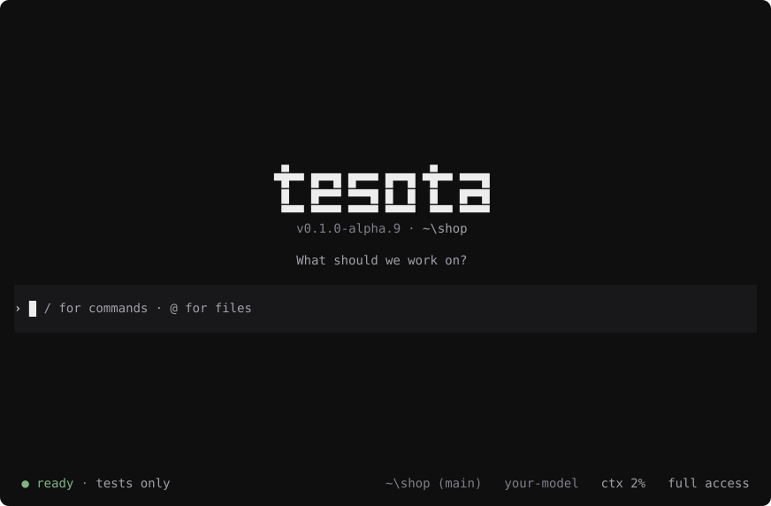

# Your first session

Any Git repository works. A project with a test command and LemmaScript
contracts shows the most.

## 1. Open Tesota

```sh
cd my-project
tesota
```

<picture>
  <source media="(prefers-color-scheme: light)" srcset="../assets/tesota-welcome-light.svg">
  
</picture>

The footer says what Tesota can verify here: `proofs and tests`,
`proofs only`, `tests only`, or `nothing to check with`.

## 2. Ask for a change

```text
Take 10% off orders over 100, with a contract and a test for it.
```

Tesota asks before anything that isn't a read; Shift+Tab switches to full
access or read only ([Permissions](../guides/permissions.md)). While it
works, Esc stops it, Enter steers it, and Alt+Enter queues a follow-up.

## 3. Watch it verify

When the agent says it's done, the orb turns indigo and the label reads
`Verifying…`, naming each step. A failing proof or test, or a contract too
weak to catch a change, goes back to the agent:

```text
↺ Sent back to the agent: the tests fail
```

A failure that repeats stops going back and is reported instead.

## 4. Read the receipt

```text
Tesota receipt
Evidence standing: verified
No review flags · no verification limits

Request context
Request 1: Take 10% off orders over 100, with a contract and a test for it.

Code evidence
✓ Tested      npm test · 0:04
✓ Proved      src/discount.ts · 0:03
○ Models      none recorded
✓ Exercised   1 test file failed on the base and passed with the change

Specification evidence
✓ Contracts   1 contract: every decided change broke its proof

Request review — model opinion
Contract comparison: completed
Open cases: listed — none listed
Acceptance remains with the reviewer.
```

- **Evidence standing** summarizes mechanical checks. Flags, limits and
  opinions have separate counts. Request review states whether the model
  comparison and open-case listing ran; an empty listing is not agreement.
- **Each method** says what ran. `Exercised` means the new test fails
  without the change; `Contracts` means every small change Tesota made to
  the code broke the proof.
- **Ctrl+O** shows every path, output and assumption.

The footer keeps it in brief: `✓ receipt · 1 proved · tests pass`. A `○`
there means the run isn't verified.

## 5. Take it to a pull request

Commit the change, then:

```sh
tesota receipt
```

It prints the receipt as Markdown for the pull request.

## Next

- [Verification](../guides/verification.md): give Tesota more to check.
- [Model checking](../guides/model-checking.md): check a design.
- [Sessions](../guides/sessions.md): several requests at once.
