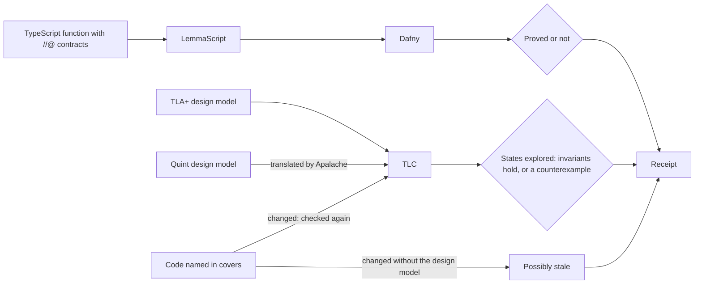

# Model checking

A proof covers one function and a test covers the cases you wrote; neither
sees two workers whose steps interleave. A design model does: a small TLA+
or Quint description of the state, the steps that change it, and a rule
that must always hold. TLC tries every order of the steps and confirms the
rule, or shows the order that breaks it.

Write one for steps that interleave: workers sharing a counter, a lock, a
retry, two sessions writing one file.



## An example: two workers and a counter

Two workers each read a count and write it back plus one. With a lock the
count ends at 2; without one, both can read 0 and write 1.
`models/Counter.tla`:

```tla
(* tesota-model
   covers: src/counter.ts increment
   confirmed: 3b7e7bc9
   invariant: NoLostUpdate
   atomic: each read and each write of the stored count
   omits: crashes; more than two workers
   fault: models/CounterNoLock.cfg the lock removed
*)
---- MODULE Counter ----
EXTENDS Naturals
CONSTANT UseLock
VARIABLES count, pc, seen, holder

Workers == {1, 2}
vars == <<count, pc, seen, holder>>

Init == /\ count = 0
        /\ pc = [w \in Workers |-> "read"]
        /\ seen = [w \in Workers |-> 0]
        /\ holder = 0

\* A worker takes the lock, if there is one, and reads the count.
Read(w) == /\ pc[w] = "read"
           /\ UseLock => holder = 0
           /\ holder' = IF UseLock THEN w ELSE holder
           /\ seen' = [seen EXCEPT ![w] = count]
           /\ pc' = [pc EXCEPT ![w] = "write"]
           /\ UNCHANGED count

\* It writes what it read, plus one, and lets the lock go.
Write(w) == /\ pc[w] = "write"
            /\ count' = seen[w] + 1
            /\ holder' = IF UseLock THEN 0 ELSE holder
            /\ pc' = [pc EXCEPT ![w] = "done"]
            /\ UNCHANGED seen

Finished == /\ \A w \in Workers : pc[w] = "done"
            /\ UNCHANGED vars

Next == (\E w \in Workers : Read(w) \/ Write(w)) \/ Finished

\* Once both workers are done, neither increment was lost.
NoLostUpdate == (\A w \in Workers : pc[w] = "done") => count = 2
====
```

`models/Counter.cfg` checks the design with the lock:

```text
CONSTANT UseLock = TRUE
INIT Init
NEXT Next
```

`models/CounterNoLock.cfg`, the planted fault, sets `UseLock = FALSE`.
Tesota checks both:

```text
Model-checked: NoLostUpdate holds in all 9 reachable states; caught 1 of 1 planted fault; not linked to the code.
```

A design model that still passes with its fault planted is too weak to
trust.

## The header

A comment starting with `tesota-model`: in TLA+ before the `MODULE` line,
in Quint in a `/* … */` or `//` comment.

| Key | |
| --- | --- |
| `covers` | A file the model describes, from the project root, and its functions; one per file, including injected dependencies such as a lock |
| `confirmed` | Optional: the commit at which someone last confirmed the model describes the code |
| `invariant` | The definitions TLC checks, separated by commas |
| `atomic` | What the model treats as one indivisible step |
| `omits` | What the model leaves out |
| `fault` | A variant that must break an invariant: another `.cfg`, a `.tla` with its own `.cfg`, or a `.qnt` |
| `replay` | Optional: a command that replays the model's traces against the code |

A TLA+ model uses the `.cfg` beside it, plus the header's invariants. A
path outside the project isn't read.

## When it runs

When a request changes a model or a file it covers, Tesota checks it once
before the run ends: the model, then its faults, then `replay`, each with
five minutes, and TLC with 2 GB of memory. The agent gets a `check_model`
tool while it works. A counterexample goes back as numbered steps; a fault
that passes goes back as too weak; a model written without a header goes
back once with the format. Without Java or TLC the receipt says it wasn't
checked ([Installation](../reference/installation.md#tools)).

Quint typechecks first, then needs Apalache to translate for TLC, which
Windows can't start; write models there in TLA+.

## What the receipt says

| Receipt | Meaning |
| --- | --- |
| Model-checked | The invariants hold in every reachable state, and every fault broke one |
| Model-checked, written with the code | The same, but the model changed with the code, so it may mirror it: weaker evidence, not stale |
| Model fails | A state breaks an invariant; the steps follow |
| Model too weak | A planted fault passes, or couldn't be checked |
| Model not checkable | TLC couldn't read it |
| Model not checked | Java, TLC or Quint is missing, it ran out of time, or it has no header |
| Model possibly stale | Covered code changed since `confirmed`, without the model |
| Model staleness unknown | No `confirmed`, or a commit the repository doesn't have |

The result is about the model, for what it treats as atomic and the
invariants it names. Without a passing `replay`, it's "not linked to the
code".

## See what TLC explored

Each TLA+ check captures the model graph: the states TLC reached and the
steps between them. `/graph` opens the newest one full-screen; `!` marks a
state that breaks an invariant.

`g` groups states by up to two variables, `n` and `p` jump between breaking
states, `t` shows TLC's trace, and `o` opens a self-contained HTML page in
your browser; every key is in [Commands and keys](../reference/commands.md#model-graph-viewer).

`/graph --plain`, the inline shell and terminals under 40×12 print the
graph as text. Over SSH, `tesota graph --html <capture>.manifest.json`
writes the page to copy elsewhere. The files sit beside the session, not
in the project, and never change the receipt. A graph is **partial** when
TLC stopped early (counts are lower bounds), and **unavailable** past
16 MiB of output, 10,000 states or 50,000 edges, or on an error other than
a broken invariant. Quint captures no graph.

## Related

[Verification](verification.md) · [Receipts](receipts.md) ·
[Checks](../reference/checks.md#design-models)
