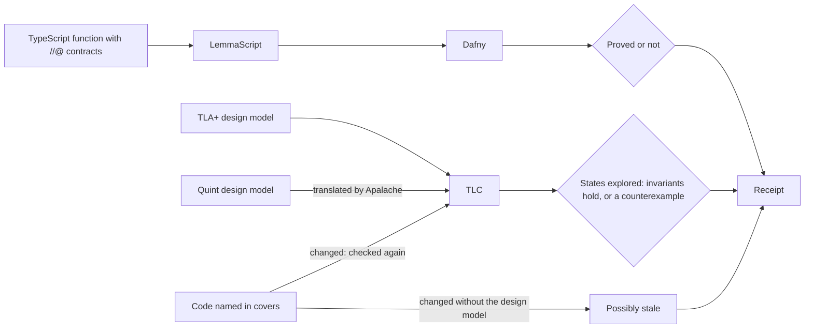

# Model checking

A proof covers one function for every input, and a test covers the cases
you wrote. Neither sees two workers whose steps interleave. A design model
does. It is a small description of the design, written in TLA+ or Quint:
the state, the steps that change it, and a rule that must always hold. A
model checker, TLC, then tries every order of those steps and either
confirms the rule in every state it reaches or shows you the order that
breaks it.

Write one when the code has steps that can interleave: workers sharing a
counter, a lock, a retry, two sessions writing one file.



A proof checks a function against its contract; a design model checks the design its header says the code follows.

## An example: two workers and a counter

Two workers each read a stored count and write it back plus one. With a
lock around the read and the write, the count ends at 2. Without it, both
can read 0 and both write 1. This TLA+ model describes that, in
`models/Counter.tla`:

```tla
(* tesota-model
   covers: src/counter.ts increment
   confirmed: 3b7e7bc9
   invariant: NoLostUpdate
   atomic: each read and each write of the stored count
   omits: crashes; more than two workers
   fault: models/CounterNoLock.cfg the lock removed
*)
---- MODULE Counter ----
EXTENDS Naturals
CONSTANT UseLock
VARIABLES count, pc, seen, holder

Workers == {1, 2}
vars == <<count, pc, seen, holder>>

Init == /\ count = 0
        /\ pc = [w \in Workers |-> "read"]
        /\ seen = [w \in Workers |-> 0]
        /\ holder = 0

\* A worker takes the lock, if there is one, and reads the count.
Read(w) == /\ pc[w] = "read"
           /\ UseLock => holder = 0
           /\ holder' = IF UseLock THEN w ELSE holder
           /\ seen' = [seen EXCEPT ![w] = count]
           /\ pc' = [pc EXCEPT ![w] = "write"]
           /\ UNCHANGED count

\* It writes what it read, plus one, and lets the lock go.
Write(w) == /\ pc[w] = "write"
            /\ count' = seen[w] + 1
            /\ holder' = IF UseLock THEN 0 ELSE holder
            /\ pc' = [pc EXCEPT ![w] = "done"]
            /\ UNCHANGED seen

Finished == /\ \A w \in Workers : pc[w] = "done"
            /\ UNCHANGED vars

Next == (\E w \in Workers : Read(w) \/ Write(w)) \/ Finished

\* Once both workers are done, neither increment was lost.
NoLostUpdate == (\A w \in Workers : pc[w] = "done") => count = 2
====
```

Beside it, `models/Counter.cfg` checks the design with the lock:

```text
CONSTANT UseLock = TRUE
INIT Init
NEXT Next
```

and `models/CounterNoLock.cfg`, the planted fault, the same with
`UseLock = FALSE`. Tesota checks both and reports:

```text
Model-checked: NoLostUpdate holds in all 9 reachable states; caught 1 of 1 planted fault; not linked to the code.
```

The planted fault shows the invariant can fail: without the lock, TLC
finds the order that loses an update (both workers read 0, both write 1).
A caught fault is counted in the report; its steps aren't shown. A design
model that still passes with its fault planted is too weak to trust.

## The header

A design model declares itself in a comment that starts with
`tesota-model`: in TLA+, before the `MODULE` line; in Quint, in a
`/* … */` or `//` comment.

| Key | |
| --- | --- |
| `covers` | A file the design model describes, from the project root, and the functions in it. Repeat it for each file, including injected dependencies such as a lock |
| `confirmed` | The commit at which someone last confirmed that the design model describes the code. Move it forward only after confirming that again |
| `invariant` | The definitions TLC checks as invariants, separated by commas |
| `atomic` | What the design model treats as one indivisible step |
| `omits` | What the design model leaves out |
| `fault` | A variant that must break an invariant, and what it plants: another `.cfg` of the same TLA+ model, a `.tla` with its own `.cfg`, or a `.qnt` |
| `replay` | Optional: a command that replays the design model's traces against the code |

Every key but `confirmed` and `replay` is required. A TLA+ model uses the
`.cfg` beside it, and Tesota adds the header's invariants to it. A path
that leaves the project isn't read.

## When Tesota checks a design model

When a request changes a design model, or a file its header covers, Tesota
checks it once before the run ends; content it already checked keeps that
check. The planted faults run only once the design model itself passes,
and the `replay` command only once both have. Each of these processes has
its own 5-minute limit, and TLC 2 GB of memory; there is no limit on
them together. Where Tesota finds TLC, the agent also gets a
`check_model` tool, and works until its design model passes.

When the design model itself breaks an invariant, the counterexample goes
back to the agent as numbered steps in the design model's names. A fault
that passes goes back as too weak. A TLA+ or Quint file the request wrote
without a header goes back once, with the format. Without Java or TLC,
the receipt says the design model wasn't checked, and the run doesn't
fail for it. [Install](../get-started/install.md#tools-the-binary-doesnt-include)
says where Tesota finds TLC.

### Quint

TLC checks Quint models too. Quint first typechecks the design model,
then needs Apalache to translate it to TLA+ for TLC; the typecheck and
the check each have their own 5-minute limit. On Windows Quint can't
start Apalache, so write design models there in TLA+.

## What the receipt says

| Receipt | Meaning |
| --- | --- |
| Model-checked | The invariants hold in every reachable state, and every planted fault broke one |
| Model-checked, written with the code | The same, but the request changed the design model and the code it covers together, so the design model may mirror the code; it counts as weaker evidence, and it isn't stale |
| Model fails | TLC found a state that breaks an invariant; the steps follow |
| Model too weak | A planted fault passes, or couldn't be checked |
| Model not checkable | TLC couldn't read the design model |
| Model not checked | Java, TLC or Quint is missing, the check didn't finish in time, or the file has no header |
| Model possibly stale | A covered file changed since the `confirmed` commit, and the request didn't change the design model with it, or it didn't pass |
| Model staleness unknown | The header names no `confirmed` commit, or the commit isn't in the repository |

A model-checked result is about the design model. It holds for what the
design model treats as atomic and leaves in, and only for the invariants
it names. Unless the `replay` command passes, the receipt says it's "not
linked to the code".

A request that changes covered code alone makes the design model possibly
stale, until someone confirms it again and moves `confirmed` forward. A
request that changes the design model and its code together, and whose
check passes, leaves it current: it was checked against the code as the
request leaves it.

## See what TLC explored

Each TLA+ check captures the states TLC reached and the steps between
them, the model graph. The transcript previews it under the result, using
the counterexample when TLC reported one:

```text
Open graph: /graph <name> · o inside it for the browser
Files beside the session: <name>.dot, .mmd, .txt
```

`/graph` opens the newest graph the shown session captured, or the one it
names, full-screen over the conversation. `!` marks a state that breaks an
invariant.

| Key | |
| --- | --- |
| Arrows, or drag | Pan |
| `f` | Back to the start of the view |
| `+`, `-` | One of three detail levels |
| `g` | Group states by up to two variables |
| Enter | Open the selected group |
| Tab, Shift+Tab | Select the next or previous state |
| PageUp, PageDown | Scroll the side panel, which shows the selected state's variables |
| `n`, `p` | Next or previous breaking state |
| `t` | TLC's trace, the one concrete run shown |
| `/` | Search the states |
| `o` | Open the graph in your browser |
| Esc | Close a prompt, leave a group or the trace, then close the viewer |

`/graph --plain`, the inline shell, and a terminal smaller than 40×12
append the graph's text to the conversation instead.

`o` writes a self-contained HTML page beside the capture, shows its path
and opens your browser; nothing stays running. The page groups and
searches like the viewer, expands and folds groups, shows the failing run,
and shows the TLA+ definition of a broken rule. Over SSH, write the page
without opening a browser and copy it to a machine with one:

```sh
tesota graph --html /path/to/capture.manifest.json
```

The files sit beside the session's `.jsonl`, not in the project. The
graph never changes the receipt, and sometimes there's none:

- **Partial:** TLC stopped before exploring every state. The graph is
  shown, its counts are lower bounds, and zero breaking states doesn't
  show the design is safe.
- **Unavailable:** the capture went over 16 MiB of output, 10,000 states
  or 50,000 edges, or TLC reported an error other than a broken
  invariant, such as a deadlock. No graph is published, and the preview
  says why.
- **Quint:** a Quint check captures no graph.

## Related

- [Verification](verification.md)
- [Receipts](receipts.md)
- [How verification works](../concepts/verification.md)
